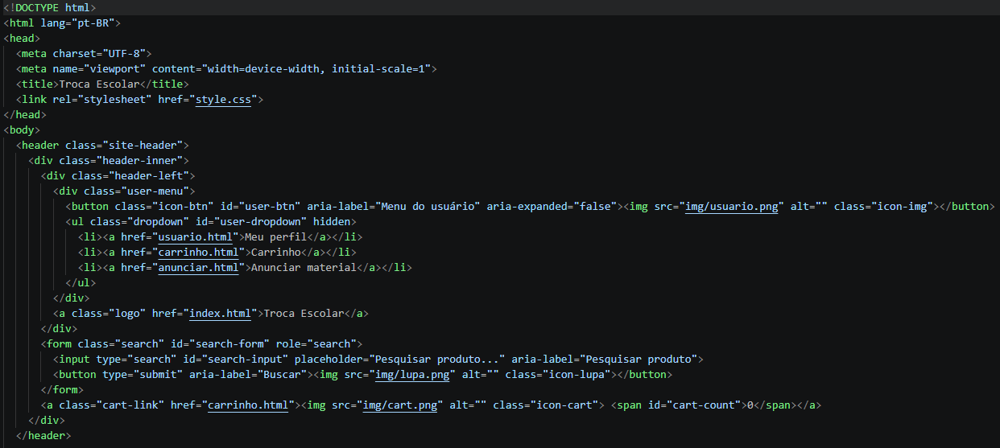
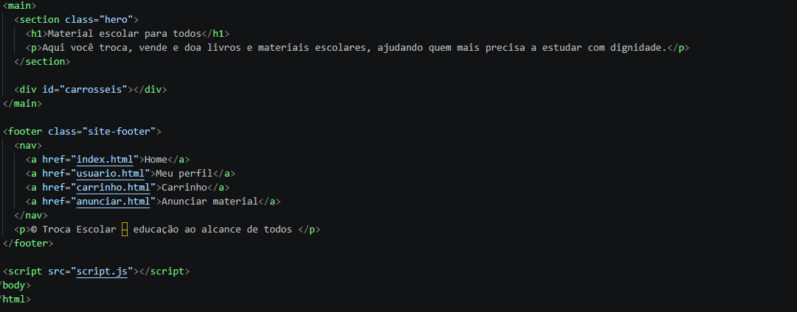
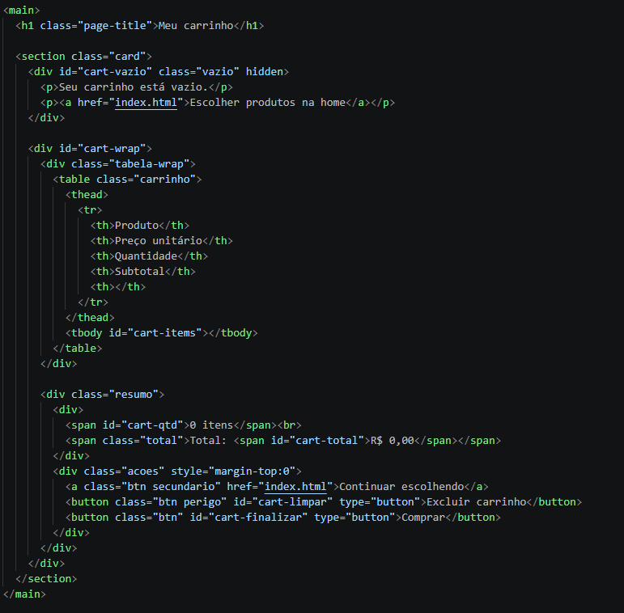
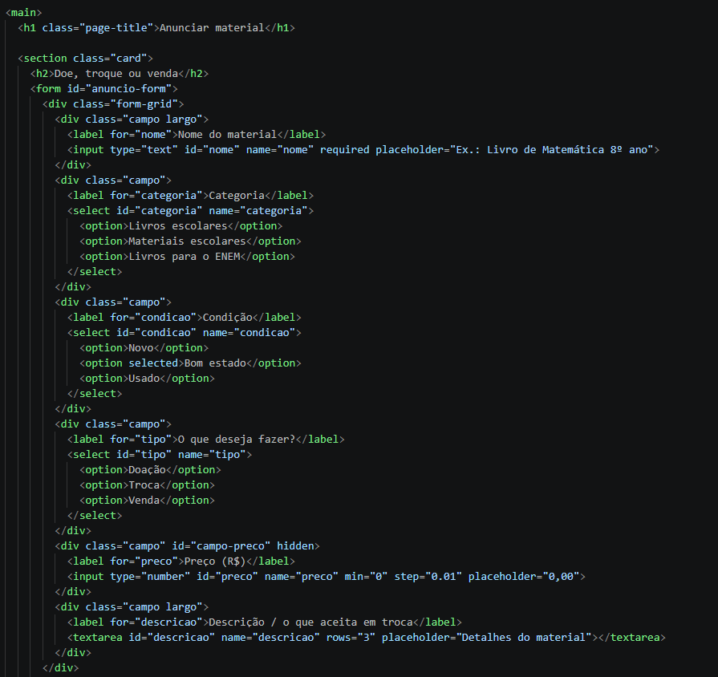
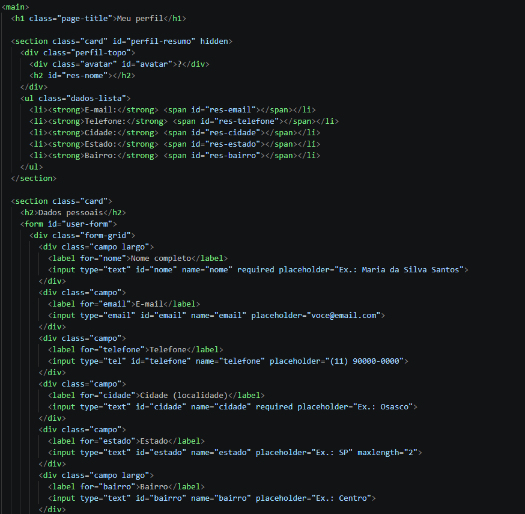
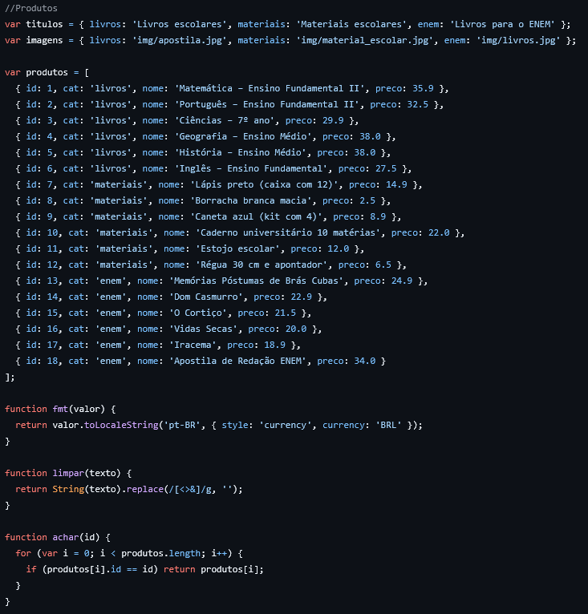
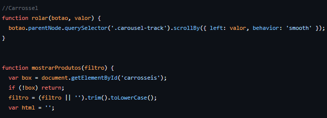
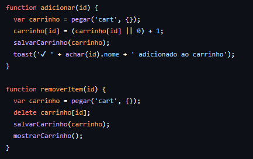
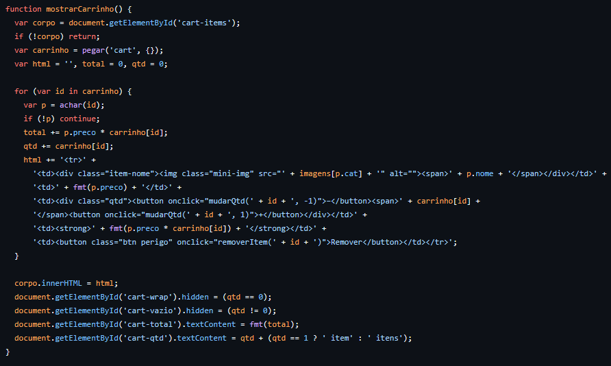
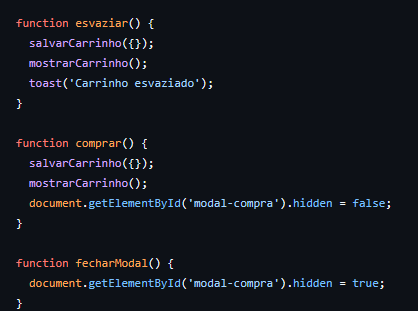

# TradeSchool

## O que é?

**TradeSchool** é um projeto em que o grupo **Ctrl + S Society** fez para tentar fornecer ajuda ou algum auxilio para pessoas que não possuem renda muito alta e querem conseguir de alguma forma o conhecimento que não possuem.
Pessoas que procuram tentar ENEM ou até mesmo por que querem conhecer alguma obra literária, tem a opção de vender ou doar ao site para que alguma instituição ou escola que precise adquire este material para se estudar
em escolas publicas etc.

## Tecnologias Utilizadas

Durante o processo de criação do projeto foi pensando em algumas tecnologias para se utilizar, as tecnologias que foram confortáveis para se utilizar na criação de paginas foi o **HTML**, **JS** e **CSS**

### HTML

Foi tentado o uso de HTML semântico durante o projeto, todas as paginas web que tiveram o uso de HTML tiveram o cabeçalho semelhante a página index.

No index o header foi dividido em três partes o esquerdo para colocar a utilização do perfil, o meio seria como uma barra de pesquisa para produtos e a direita o carrinho que estaria armazenando todos os produtos que o 
usuário estaria adicionando para adquirir.

Em seu corpo não apresenta tanto conteúdo por possuir um carrossel com os produtos que a maior parte estará no JS.

No corpo do carrinho, se o usuario clicar em adicionar para o carrinho na pagina index, ira ter conteúdo na pagina dizendo a quantidade de produtos que o usuario pegou do mesmo produto, ira calcular automaticamente os preços 
etc.

Tanto no corpo da pagina de anuncio quanto na da pagina de perfil são formulários, porém ambos são diferentes um do outro. Na pagina de anuncio o usuario estaria ou doando, caso não coloque nenhum valor, ou vendendo.

### JS

Foi utilizado o JS para adicionar interatividade, dinamismo e lógica a página web.

O JS utilizado para o index para listar os produtos e adicionar o carrossel.

O JS usado no carrinho foi para linkar ele com a pagina index, para poder adicionar os produtos de uma pagina para outra, para poder adicionar, retirar, excluir e comprar produtos da pagina do carrinho.

### CSS

O **CSS** foi utilizado para fazer estilização no site , como alterações no cabeçalho, uso de cores e formatações para o site não ficar bambeado para nenhum lado.

